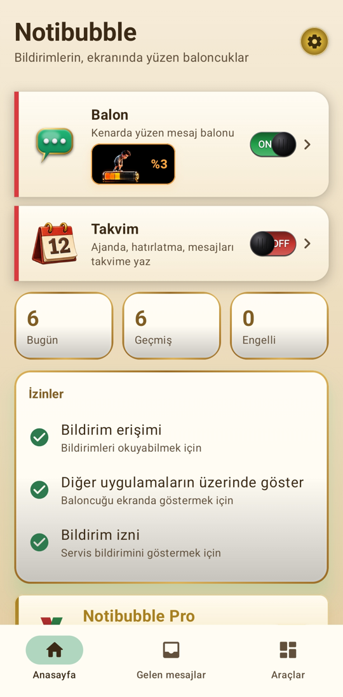
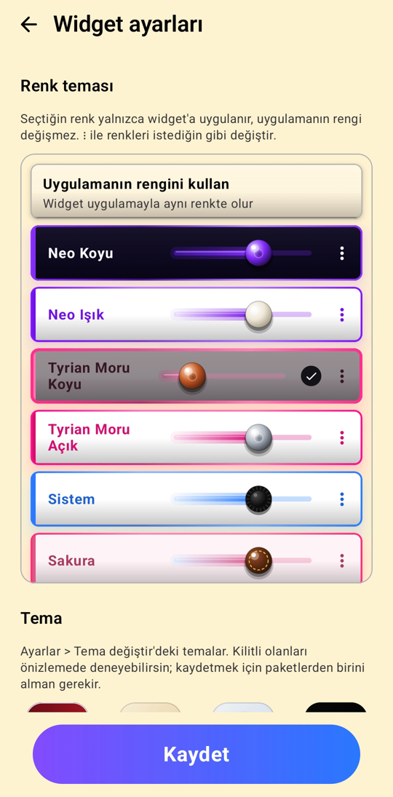
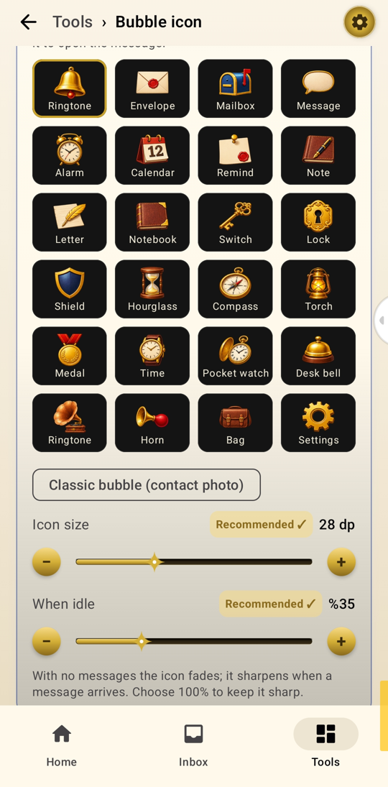

  

<h1 align="center">Dekorher</h1>

Android uygulamaları · kabartmalı, şık ve az pil tüketen

---

## Notibubble

Telefonuna gelen bildirimleri kabartmalı baloncukta, widget'ta ve mesaj penceresinde gösterir.

  
  &nbsp;
  
  &nbsp;
  

**Öne çıkanlar**

- Mesajlar ekranın kenarında kabartmalı baloncukta
- Ana ekran widget'ı: bugünün mesajları, takvim, renk ayarı
- Dosyaya, takvime ve Drive'a kaydetme, hatırlatma
- Arka planda gereksiz çalışmaz, pil dostu

[Gizlilik politikası](notibubble-gizlilik.md)

---

Yapımcı: <b>Dekorher</b> · dekorher@gmail.com

